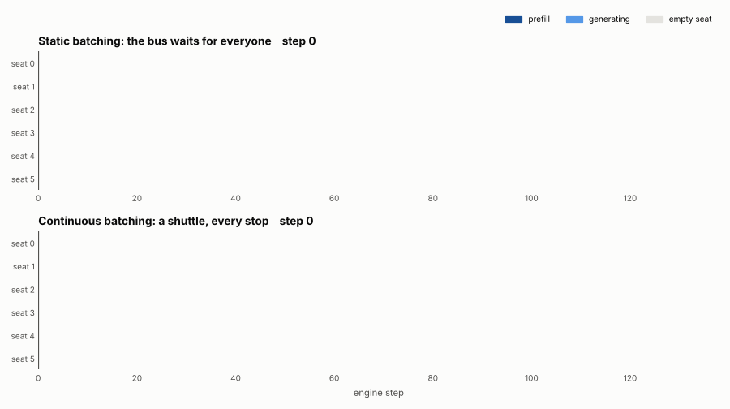
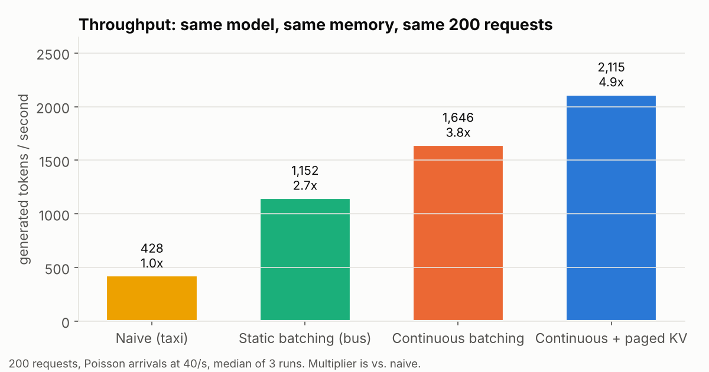
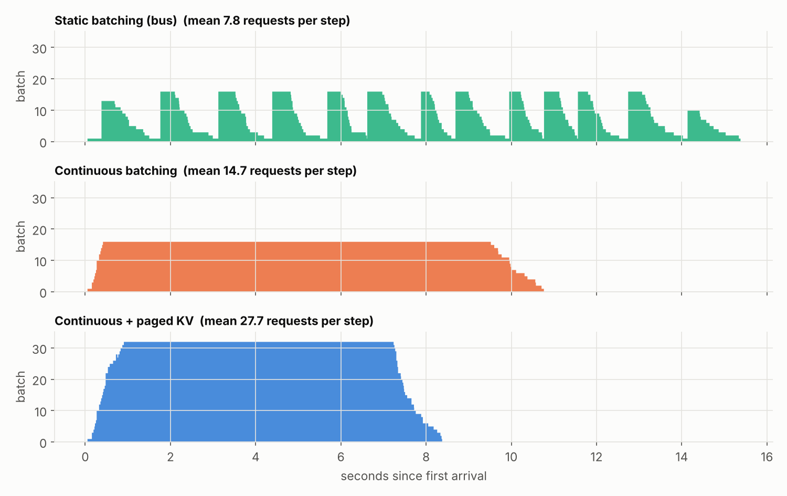
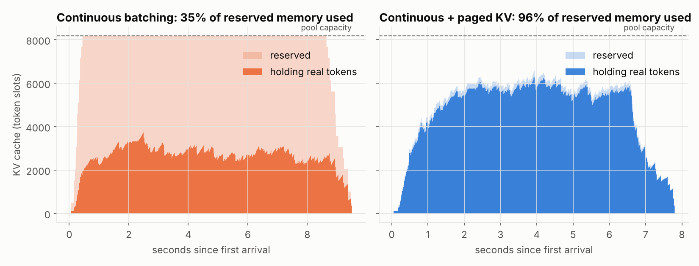
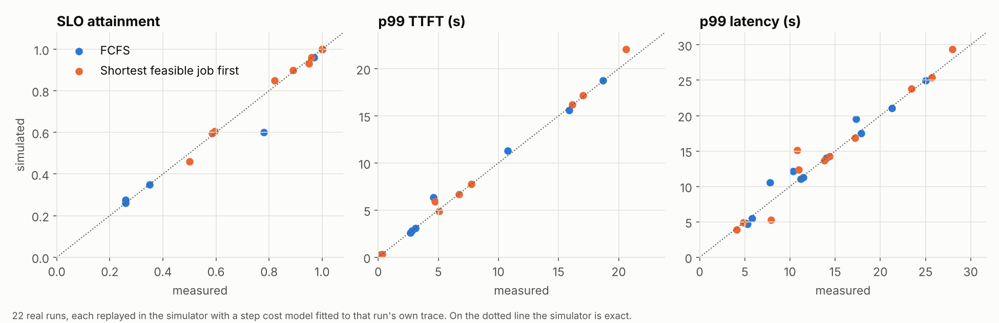
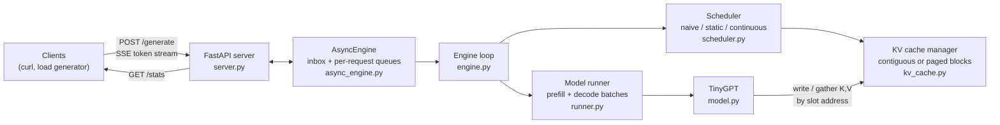

<div align="center">

# 🚐 TinyServe

**A tiny LLM inference engine, built from scratch to show how production model serving actually works.**

Continuous batching · paged KV cache · fused C++ paged attention · prefix caching · chunked prefill · speculative decoding · SLO-aware scheduling · token streaming.

[](https://www.python.org/)
[](LICENSE)
[](https://github.com/Usman-Siddiqi/TinyServe/actions/workflows/ci.yml)
[](https://github.com/astral-sh/ruff)

</div>

> [!NOTE]
> The model inside TinyServe has **random weights** (fixed seed), so everything it writes is gibberish. That is on purpose. This project is about the *serving system* around a model: how requests are queued, batched, scheduled, given memory and streamed back. A real checkpoint would make the output readable but would not change a single line of the engine.

<p align="center">
  
</p>

## Why this exists

Serving an LLM to many users at once is mostly a scheduling and memory problem, not a math problem. The math (one transformer forward pass) is the same for everyone. What differs between a toy and a production server like vLLM or TGI is how it decides **who gets to run on the next step** and **where their memory lives**.

Think of the GPU (here, the CPU) as a vehicle carrying passengers (requests) who each travel a different distance (number of tokens to generate):

| | Strategy | Analogy | What goes wrong |
|---|---|---|---|
| 🚕 | **Naive** | A **taxi**: one passenger, door to door. | Everyone else waits at the curb. The hardware does one small job at a time and sits mostly idle. |
| 🚌 | **Static batching** | A **bus that waits for everyone**: it fills up, drives, and nobody new can board until the last passenger gets off. | Short trips finish early and their seats ride empty until the longest trip is done. New arrivals wait for the whole bus to come back. |
| 🚐 | **Continuous batching** | A **shuttle that stops at every step**: people get off the moment they arrive, and whoever is waiting takes the free seat right away. | Nothing, as long as there is room. Which is where the KV cache comes in. |

Every token a request has seen must stay in memory (the **KV cache**) until it finishes. If you reserve that memory the simple way, one big slab sized for the longest possible request, most of it sits empty and only a handful of passengers fit in the shuttle. A **paged KV cache** hands out memory in small fixed-size blocks as requests actually grow, like an operating system's virtual memory pages. Same memory, roughly twice the passengers.

TinyServe implements all of that from scratch, measures it, and draws it.

## Results

The benchmark fires the **same 200 requests** (Poisson arrivals, random prompt lengths of 16 to 192 characters and long-tailed output lengths of 10 to 300 tokens, fixed seed) at six engine configurations that share the **same model and the same KV memory budget** (8,192 token slots).

<p align="center"></p>

| Strategy | Throughput (tok/s) | vs. naive | p50 latency | p95 latency | p50 TTFT | p95 TTFT | Mean batch | KV utilization |
|---|---:|---:|---:|---:|---:|---:|---:|---:|
| Naive (taxi) | 482 | 1.0x | 16.81 s | 29.63 s | 16,628 ms | 29,133 ms | 1.0 | 35% |
| Static batching (bus) | 1,394 | 2.9x | 4.28 s | 7.23 s | 4,082 ms | 6,586 ms | 8.0 | 39% |
| Continuous batching | 1,865 | 3.9x | 2.76 s | 4.42 s | 2,130 ms | 3,638 ms | 14.9 | 35% |
| Continuous + paged KV | 2,271 | 4.7x | 1.59 s | 3.33 s | 676 ms | 1,611 ms | 26.8 | 96% |
| + fused C++ attention | 2,883 | 6.0x | 0.74 s | 2.30 s | 116 ms | 468 ms | 26.4 | 96% |
| + speculative decoding | 2,119 | 4.4x | 2.01 s | 4.09 s | 868 ms | 2,302 ms | 28.3 | 96% |

Hardware: Intel(R) Xeon(R) Processor @ 2.10GHz, 4 logical cores, 4 PyTorch threads, PyTorch 2.9.1+cpu, Python 3.13.18. Commit `c05ea46`, 2026-11-18T05:17:48+00:00.

Throughput of each repeat (tok/s): Naive (taxi) 470/482/497, Static batching (bus) 1,404/1,358/1,394, Continuous batching 1,865/1,840/1,876, Continuous + paged KV 2,312/2,168/2,271, + fused C++ attention 2,883/2,834/2,992, + speculative decoding 2,051/2,119/2,258.

**What the numbers say**

- **Continuous vs. static batching: 1.3x the throughput** (1,865 vs. 1,394 tok/s) with the *same* 16-request memory limit, and p50 latency drops from 4.3 s to 2.8 s. The static batcher averages only 8.0 busy seats out of 16, because finished requests leave empty seats that cannot be refilled until the whole batch drains.
- **Paging the KV cache: another 1.2x and a third of the time-to-first-token** (p50 2.1 s to 0.68 s). Nothing about the scheduler changed; the same 8,192-slot pool simply fits 26.8 running requests on average instead of 14.9, because 96% of reserved memory holds real tokens instead of 35%.
- **The fused C++ attention kernel: another 1.27x, 6.0x over naive**, and p50 TTFT drops to 116 ms. Paging doubled the batch but each step got slower, because the torch path copies every sequence's K/V out of its blocks before attending. The kernel reads the blocks in place, so the median time per output token falls from 12.3 ms to 9.5 ms at the same batch size.
- **Speculative decoding does not pay at this load** (2,119 tok/s, 0.73x the fused run). With 28 requests per step the CPU is already compute-bound, so verifying 4 drafted tokens per request costs more than the steps it saves. It wins at small batches (up to 1.75x, [below](#speculative-decoding-speculativepy-draftpy)), which is why it is off by default.
- **End to end: 6.0x the throughput of serving one request at a time**, and the median request finishes in 0.74 s instead of 16.8 s.
- **Run-to-run noise** on the cloud VM is a few percent; every repeat is listed under the table and stored in the JSON.

<p align="center"></p>

<p align="center"></p>

The static batcher's sawtooth is the bus problem in one picture: the batch fills, drains as passengers get off, and sits half empty waiting for the longest request before anyone new can board. Continuous batching stays pinned at its limit, and with paging the limit itself doubles.

### Paged vs. contiguous KV memory

<p align="center">
  
</p>

<p align="center"></p>

With contiguous slabs, a request that ends up 120 tokens long still pins 512 slots for its whole life, so the 8,192-slot pool holds only 16 requests and most of what is reserved is empty. With 16-token pages a request only ever wastes the unused tail of its last block.

### Prefix caching, chunked prefill and smaller KV

Three more upgrades target specific traffic shapes rather than raw throughput, so each has its own A/B benchmark (median of 3 interleaved repeats, same machine; raw output in `bench/results/`):

| Upgrade | Workload | Result |
|---|---|---|
| Prefix caching (on by default in the server) | 120 chat requests sharing 4 system prompts | prefill tokens **-82%** (82% cache hit rate), p50 TTFT **29 ms to 11 ms**, p95 TTFT -74%, p50 latency -32% |
| Chunked prefill, 256-token budget (`--chunked-prefill`) | burst of long prompts arriving while 16 requests decode | worst decode stall **117 ms to 39 ms**, p99 inter-token latency -41%; the burst's own TTFT is +66% |
| Chunked prefill | default workload | throughput -1%, max inter-token gap -33% |
| bfloat16 KV (`--kv-dtype bfloat16`, same 32 MiB) | default workload | 2x the token slots, 1.04x throughput, p50 TTFT 0.72 s to 0.51 s |
| int8 KV (same 32 MiB) | default workload | 3.76x the token slots but 0.83x throughput: dequantizing in Python costs more than the memory saves when 32 seats already fit |

- **Prefix caching is free when nothing is shared**, so it is on by default: throughput is unchanged and every hit is prefill skipped.
- **Chunked prefill trades the newcomer's first token for everyone else's next one.** That is the right call for chat-style streaming, so it is a flag rather than the default.
- **Smaller KV only pays when memory is the bottleneck.** Here the 32-request batch limit binds before the 8,192-slot pool does; on a GPU serving long contexts the extra slots turn directly into batch size.

### Scheduling for goodput

Throughput is not what users feel. Production servers are judged on **goodput**: requests per second that meet a latency SLO, here a time to first token (TTFT) and a time per output token (TPOT) target. Once the shuttle is full, *who boards next* decides how many passengers arrive on time. The continuous scheduler takes a pluggable queue policy (`tinyserve/policy.py`):

| Policy | Admits first | Preempts first |
|---|---|---|
| `fcfs` (default) | oldest | newest |
| `sjf` | smallest prompt + `max_new_tokens`, with aging so big jobs cannot starve | largest |
| `edf` | earliest TTFT deadline; requests already past it go last | latest deadline |
| `slo` | *shortest feasible job*: smallest job among those that can still make their deadline; late ones last, oldest first | largest |

<p align="center"></p>

The chart is from the scheduler simulator (below): 1,000 requests per point, median of 5 seeds, SLO of TTFT <= 3 s and TPOT <= 150 ms. The sweep ran with 1 PyTorch thread on a shared, busy VM, where the engine served 445 tok/s (about 5x slower than the main benchmark), so the SLO is scaled up to match. Load is a multiple of the capacity measured by serving a burst of requests.

- **Below capacity the policy does not matter.** The queue is empty, so every policy makes the same choices.
- **Past capacity FCFS collapses.** Every request queues behind older ones that are already late, so at 1.5x load only 13% meet the SLO.
- **Demoting late requests is most of the fix.** `edf` keeps 66% on time at 1.5x. Adding shortest-first among the on-time ones (`slo`) keeps 88%: **goodput 6.9x FCFS at 1.5x load and 10x at 2x**.
- **SJF alone barely helps** (+10% at 1.5x). Short jobs finish sooner, but everyone is still late.
- **The price is the tail.** Demoted requests wait until the burst passes: p99 latency goes from 55 s to 126 s at 1.5x, and with `slo` the longest 10% of jobs wait about twice as long (median 37 s to 68 s). `edf` is the fairer option: at 1.5x its long jobs even finish sooner than under FCFS (22 s). A production server would pair either one with load shedding, so a request that is already late gets a fast "busy" answer instead of a long wait.
- **The size hint is an oracle here.** Benchmarks ignore EOS, so `max_new_tokens` is the exact output length. Real servers only know an upper bound or a predicted length.

**Real engine, heavy overload** (4x load, 200 requests, 3 interleaved repeats): `slo` beat FCFS in every repeat, median goodput **2.0x** (3.51 vs. 1.72 req/s) and 58% vs. 26% of requests on time. The median request finished in 6.9 s instead of 12.9 s, while p99 latency rose from 21.3 s to 25.7 s and the longest 10% of jobs from 18.0 s to 22.3 s. The raw runs are in [`bench/results/sweep.json`](bench/results/sweep.json).

#### A simulator for scheduling experiments

On a shared VM, the engine's speed drifted by up to about 30% between runs, and near capacity that alone swung FCFS from 78% to 100% of requests on time in two repeats of the same workload. Scheduling decisions do not depend on token values, so `tinyserve/simulator.py` replays a workload through the *real* scheduler and KV cache manager on a virtual clock, charging each step a duration from a linear cost model (fixed overhead, prefill tokens, decode context tokens) fitted to a real engine trace. A 1,000-request run takes under a second and is deterministic.

To check it, every real sweep run is replayed with a cost model fitted to its own trace. Across 22 runs the simulator's goodput is within 1.4% of the measured one (median; worst 31%), and p99 latency within 2.0% (worst 40%). The misses are single runs; one linear model per run cannot follow a machine whose speed drifts within the run.

<p align="center"></p>

## Architecture



One engine step does three things: the **scheduler** picks who runs (admitting, finishing and preempting requests while asking the **KV cache manager** for memory), the **model runner** executes one batched prefill and/or decode pass, and each request receives its new token, which the **AsyncEngine** pushes to the right HTTP stream.

## Quickstart

```bash
git clone https://github.com/Usman-Siddiqi/TinyServe.git && cd TinyServe
python -m venv .venv && source .venv/bin/activate

# CPU-only PyTorch (small download), then TinyServe itself
pip install torch==2.9.1 --index-url https://download.pytorch.org/whl/cpu
pip install -e ".[dev,bench]"

pytest                      # a few seconds; the first run also compiles the C++ kernel
```

**Run the server** (continuous batching with a paged, prefix-caching KV cache by default):

```bash
tinyserve-server --port 8000
# or: tinyserve-server --no-prefix-caching
# or: tinyserve-server --strategy static --max-batch-size 16
# or: tinyserve-server --chunked-prefill --max-tokens-per-step 256
```

**Stream a completion** over Server-Sent Events:

```bash
curl -N -X POST localhost:8000/generate \
     -H 'Content-Type: application/json' \
     -d '{"prompt": "Hello, TinyServe!", "max_tokens": 8, "temperature": 1.0, "seed": 0}'
```

```text
data: {"index": 0, "token": "f", "token_id": 74}
data: {"index": 1, "token": "_", "token_id": 67}
data: {"index": 2, "token": "M", "token_id": 49}
...
data: {"finished": true, "text": "f_Me<11", "finish_reason": "length", "num_prompt_tokens": 18, "num_generated_tokens": 8, "ttft_ms": 15.96, "latency_ms": 104.22, "num_preemptions": 0}
```

Gibberish, as promised: the weights are random.

**Check what the engine is doing** (this snapshot was taken while the load generator below was running):

```bash
curl -s localhost:8000/stats
```

```json
{
    "strategy": "continuous",
    "kv_layout": "paged",
    "queue_depth": 0,
    "batch_size": 15,
    "max_batch_size": 32,
    "kv_used_tokens": 3085,
    "kv_reserved_tokens": 3200,
    "kv_capacity_tokens": 8192,
    "kv_utilization": 0.9641,
    "kv_occupancy": 0.3906,
    "num_steps": 378,
    "num_generated_tokens": 3549,
    "num_finished_requests": 32,
    "num_preemptions": 0,
    "tokens_per_sec": 708.2,
    "uptime_sec": 8.0
}
```

With prefix caching on, `/stats` also reports `prefix_cache_hit_rate`, the hit and query token counts, evicted blocks and `kv_cached_tokens` (free slots still holding reusable KV), and each request's summary event includes `num_cached_tokens`.

**Load test it** with the async load generator (Poisson arrivals, streams every response):

```bash
tinyserve-loadgen --url http://127.0.0.1:8000 --num-requests 100 --rate 10
# chat-like traffic: every prompt starts with one of 4 shared system prompts
tinyserve-loadgen --url http://127.0.0.1:8000 --num-requests 100 --rate 5 --system-prompts 4
```

**Reproduce the benchmark and charts** (about 4 minutes on a 4-core machine):

```bash
python bench/run.py          # writes bench/results/results.json (raw, per request)
python bench/plot.py         # renders docs/assets/*.png and bench/results/results.md
python docs/make_visuals.py  # renders the two GIFs from real engine traces
python bench/prefix_caching.py  # prefix caching off vs. on, shared-prefix and default workloads
python bench/chunked_prefill.py  # chunked vs. unchunked prefill, incl. inter-token latency
python bench/sweep.py --policies fcfs slo     # goodput load sweep (real engine)
python bench/sweep.py --mode sim --calibration bench/results/sweep.json \
    --out bench/results/sweep_sim.json --policies fcfs sjf edf slo --num-requests 1000 --seeds 0 1 2 3 4
```

## Project structure

```text
tinyserve/
  model.py         TinyGPT: decoder-only transformer whose attention reads an external KV cache
  attention.py     decode attention backends: torch gather or the fused C++ kernel
  csrc/            paged_attention.cpp, the fused decode kernel (JIT-compiled)
  tokenizer.py     printable-ASCII character tokenizer
  kv_cache.py      KV pool, contiguous, paged and prefix-caching managers, block allocators
  kv_quant.py      KV storage formats: float32, bfloat16, int8 with per-token scales
  request.py       requests, sampling params, per-request timing metrics
  sampler.py       greedy / temperature sampling with per-request RNGs
  runner.py        builds padded prefill and decode batches, runs the model
  scheduler.py     naive, static and continuous batching schedulers (+ preemption)
  policy.py        queue policies: FCFS, SJF, EDF, shortest feasible job first
  simulator.py     replays a workload through a scheduler on a virtual clock
  speculative.py   speculative decoding: proposers, verification, adaptive draft length
  draft.py         early-exit and distilled draft models
  assets/          distilled draft weights (1 MB)
  engine.py        the step loop, tracing, and build_engine() from an EngineConfig
  async_engine.py  background engine thread <-> asyncio bridge
  server.py        FastAPI app: POST /generate (SSE), GET /stats, GET /health
  workload.py      reproducible Poisson workloads
  loadgen.py       async HTTP load generator
bench/
  run.py           benchmark all strategies, save raw JSON
  prefix_caching.py  A/B benchmark of prefix caching (shared-prefix and default workloads)
  chunked_prefill.py  chunked vs. unchunked prefill on default and prompt-heavy workloads
  attention.py     torch vs. C++ decode attention, per step and end to end
  plot.py          charts + results tables from the JSON files
  speculative.py   speculative vs. plain decoding, interleaved A/B
  spec_costs.py    cost of drafting and verifying relative to a decode step
  distill_draft.py trains the distilled draft from the target's samples
  sweep.py         goodput vs. load sweep of the queue policies
  results/         the raw results behind every number in this README
docs/
  make_visuals.py  animated GIFs replayed from real engine traces
  assets/          generated charts and GIFs
tests/             pytest suite, one file per component
```

## How it works

### The model (`model.py`)

A GPT-style decoder: 4 layers, 8 query heads sharing 2 key/value heads (grouped-query attention, as in Llama 2/3 and Mistral), `d_model` 512, an MLP of width 2048 and learned positional embeddings. About 11M parameters, a 101-token character vocabulary and a 512-token context. The weights come from a fixed seed under a private RNG, so the model is bit-for-bit identical everywhere.

The important design choice is that **attention does not own its history**. Each forward pass receives a `KVBatch` that says, for every new token, which slot of a shared memory pool to write its key/value to, and for every sequence, which slots hold its past. The causal mask is computed from absolute positions (`key_pos <= query_pos`), which also hides padding and stale cache entries for free. Tests check that incremental decoding with the cache matches a full recompute, and that ragged batches give the same logits as running each sequence alone.

### Prefill vs. decode (`runner.py`)

A request's life has two phases. **Prefill** pushes its whole prompt through the model in one pass, fills the cache and samples the first token: it is compute-heavy and sets time-to-first-token. **Decode** feeds one token per request per step: each step is cheap, so it is the phase that benefits most from batching many requests together. Every scheduler uses the same runner, so the comparison only measures scheduling and memory policy.

### Schedulers (`scheduler.py`)

All three share a FIFO waiting queue and a running list, and differ only in when they let requests board:

- **`NaiveScheduler`** runs one request start to finish.
- **`StaticScheduler`** boards up to `max_batch_size` requests when the batch is empty and runs them until all are done. It is given a head start: finished requests are dropped from the compute rather than decoded as padding.
- **`ContinuousScheduler`** re-plans at every step. It first reserves KV room for every running request's next token, preempting the newest request if memory runs out. Then it admits waiting requests in FIFO order (or the order of another [queue policy](#scheduling-for-goodput)) while there is a free seat, the step's token budget (`max_tokens_per_step`, which bounds how long a burst of long prompts can stall everyone else) allows it, and their KV memory fits. Newcomers are prefilled in the same step the others decode.
  With `chunked_prefill=True` (Sarathi-Serve style), a prompt no longer has to fit in one step: the budget is filled decode-first, then with prefill chunks, continuing prefills that are under way before admitting anyone new. Steps stay roughly the same size, so a burst of long prompts cannot stall everyone's next token. A request samples only once its last chunk is in.

Preemption uses **recompute**: the victim's memory is freed and it goes back to the front of the queue keeping the tokens it generated. On readmission its whole sequence is prefilled again, which costs compute but needs no extra memory (vLLM's default strategy). A test squeezes six requests into memory for two and checks that outputs are unchanged.

### KV cache (`kv_cache.py`)

The pool is plain storage, per layer a `(num_slots, n_kv_heads, head_dim)` tensor for keys and one for values. Managers decide which slots belong to which sequence, and the two layouts differ only in their address function:

| Layout | Reserves | Address of token `j` of a sequence |
|---|---|---|
| `ContiguousKVCache` | a `max_seq_len` slab per request, up front | `row * max_seq_len + j` |
| `PagedKVCache` | 16-token blocks, on demand | `block_table[j // 16] * 16 + j % 16` |

`BlockAllocator` is a free list of block ids. Because every block has the same size there is no external fragmentation and nothing to compact, and a freed block is immediately reusable by anyone. Each sequence keeps a block table mapping logical blocks to physical ones, which can be scattered anywhere in the pool. `KVUsage` reports used slots (holding a real token), reserved slots (handed out) and capacity, so utilization is `used / reserved`.

**Prefix caching** (`PrefixCachingKVCache`, vLLM-style). Each full block is identified by a hash chained over its parent block's hash and its own token ids, so equal hashes mean equal prefixes and therefore equal KV. On admission the scheduler looks up the longest run of cached blocks at the start of the request, shares them (reference counted in `CachingBlockAllocator`) and sets `num_computed_tokens` so prefill skips them; the last token is always computed so the request can sample. Only full blocks are shared and nobody writes to a full block again, so there is no copy-on-write. When a sequence finishes, its cached blocks keep their KV as evictable free space and are reclaimed least-recently-used first, only when no clean block is left. Requests sharing a system prompt skip most of their prefill, a follow-up chat turn reuses the previous turn's KV, and a preempted request usually finds its own blocks again on readmission.

By default, attention gathers each sequence's keys and values through those addresses into a dense tensor. Rows are sorted by length and attended in groups of 8 so a 20-token sequence is not padded out to a 450-token one in the same batch.

The `cpp` attention backend skips that copy during decode. [`csrc/paged_attention.cpp`](tinyserve/csrc/paged_attention.cpp) is a small PagedAttention-style kernel: it walks each sequence's block table and reads K/V straight from the pool, with an online softmax, no padding, OpenMP threads over (sequence, KV head) pairs, and the 4 query heads of each GQA group sharing every K/V load. A contiguous cache is treated as a paged one with a single `max_seq_len` block. It is JIT-compiled with `torch.utils.cpp_extension` on first use; if no compiler is available TinyServe warns and falls back to `torch`. Select it with `EngineConfig(attention="cpp")`, `tinyserve-server --attention cpp` or `TINYSERVE_ATTENTION=cpp`. Prefill and the bf16/int8 caches always use the torch path.

### Speculative decoding (`speculative.py`, `draft.py`)

Off by default; enable with `EngineConfig(speculative="distilled")` or `tinyserve-server --speculative distilled`. Each decode step a proposer drafts up to `k` tokens per request, the target scores the latest token plus all drafts in one pass over the paged cache, and the longest agreeing prefix is kept plus one token from the target. Rejected drafts are rolled back with `KVCacheManager.truncate`. Greedy requests accept exact argmax matches, so their output is identical to plain decoding (tested, and checked by the benchmark). Sampled requests use rejection sampling (Leviathan et al., 2023), which keeps the target's output distribution.

Three proposers:

- `ngram`: prompt lookup, copies what followed an earlier occurrence of the last few tokens. No model.
- `early-exit`: the target's first layer plus its LM head, with its own KV cache.
- `distilled`: a 1-layer, 128-wide model (1 MB) trained in about 4 minutes on 2 CPU threads to match the target's next-token distribution on its own samples (`bench/distill_draft.py`).

A draft only helps if it agrees with the target, and this target has random weights. Its next-token distribution is close to "repeat the previous character, otherwise near uniform", and the temperature decides which part dominates. Greedy decoding repeats one character, which makes n-gram lookup look far better than it would on real text. The temperatures in the table cover the range: at 0.3 the distribution is peaked but not degenerate, so draft quality matters most there.

Speedup in wall-clock time to finish a batch of 64-token requests, with a fixed `k = 4` (`adaptive_speculation=False`), median of 5 interleaved repeats on a shared 4-core VM (expect ±15% noise; raw data in `bench/results/speculative.json`):

| Temperature | Draft | Tokens per verification | Batch 1 | Batch 4 | Batch 8 |
|---|---|---:|---:|---:|---:|
| 0 (greedy) | n-gram | 4.1 | 2.68x | 1.81x | 1.62x |
| 0 (greedy) | distilled | 3.9 to 4.4 | 1.75x | 1.43x | 1.49x |
| 0.3 | n-gram | 1.2 | 0.86x | 0.53x | 0.51x |
| 0.3 | distilled | 3.3 | 1.22x | 1.03x | 0.99x |
| 1.0 | n-gram | 1.0 | 0.82x | 0.49x | 0.47x |
| 1.0 | distilled | 4.1 to 4.3 | 1.60x | 1.23x | 1.23x |

- **The distilled draft is the only one that holds up when sampling.** On held-out samples its expected per-token acceptance is 0.84 at temperature 0.3, against 0.43 for the early-exit draft (`bench/results/distill_draft.txt`).
- **Gains shrink with batch size.** Speculation spends extra compute to save sequential steps. At batch 1 the CPU has compute to spare; at batch 8 a plain decode step is already busy, so the extra drafted and verified tokens cost relatively more (per-step costs in `bench/results/spec_costs.txt`).
- **Bad drafts are expensive.** With a fixed `k`, n-gram drafts at temperature > 0 halve throughput. The default `adaptive_speculation=True` estimates each request's acceptance rate and picks the draft length with the best expected tokens per unit of cost, dropping to plain decoding when drafts keep failing. In the A/B run at temperature 0.3 this lifted the early-exit draft from 0.65x/0.48x/0.42x to 1.02x/0.97x/1.03x and n-gram at batch 4 and 8 from 0.59x/0.56x to 1.07x/0.88x. It is conservative, so with a good draft it can give up some of the gain of a fixed `k`.

### Server (`async_engine.py`, `server.py`)

The engine is synchronous PyTorch, so it runs in one background thread looping `engine.step()`. HTTP handlers on the asyncio loop talk to it through a thread-safe **inbox** (add / abort commands) and one `asyncio.Queue` per request that the engine thread fills via `loop.call_soon_threadsafe`. Only the engine thread touches the engine, so it needs no locks. `POST /generate` streams each token as an SSE `data:` event and ends with a summary event (finish reason, TTFT, latency). If the client disconnects mid-stream, the request is aborted and its KV blocks are freed. `GET /stats` reports queue depth, batch size, KV utilization and occupancy, preemptions and a rolling tokens/sec.

### Benchmark (`bench/`)

`bench/run.py` builds a fresh engine per configuration, warms it up, then injects the workload in real time at the Poisson arrival times, so queueing delay counts toward latency exactly as it would for users. The engine is driven in-process (no HTTP), so the numbers measure the serving system rather than JSON and sockets. Each configuration runs three times, interleaved, and the median-throughput run is reported. All raw per-request and per-step data is in [`bench/results/results.json`](bench/results/results.json).

## Limitations

- **CPU only.** Everything runs on PyTorch's CPU kernels. Absolute numbers are tiny next to a GPU, and the shared cloud VM the benchmark ran on adds a few percent of run-to-run noise (all repeats are listed under the table).
- **Random weights.** The output is noise. Under greedy decoding the model tends to repeat one character; use `temperature` for more varied noise.
- **Simplified attention by default.** The default `torch` backend gathers each sequence's K/V from its blocks into a temporary dense tensor and calls PyTorch's `scaled_dot_product_attention`. That extra copy is the main cost of decoding long sequences in big batches, and it is why nearly doubling the batch with paging buys only 1.2x more throughput here. The opt-in `cpp` backend removes it for decode (1.27x end to end); it is float32 only and needs a C++ compiler with OpenMP. Prefill batches are padded to their longest prompt.
- **A toy model and tokenizer.** 11M parameters, a character vocabulary, learned positions instead of RoPE, float32 throughout.
- **No prefill/decode disaggregation.** Chunked prefill is opt-in, and a step's prefill chunks and decodes still run as two forward passes.

## Roadmap

- [x] **Prefix caching**: share KV blocks between requests with a common prompt prefix (block hashing plus reference counts in the allocator).
- [x] **Speculative decoding**: a smaller draft model proposes several tokens and the main model verifies them in one pass.
- [x] **C++ paged-attention kernel**: read K/V straight from the blocks instead of gathering them into a temporary tensor (decode; `--attention cpp`).
- [ ] **Preemption by swapping**: move a victim's blocks to a CPU-side pool instead of recomputing them.
- [x] Chunked prefill, so long prompts never stall decoding.
- [x] A bf16 or int8 KV cache: `--kv-dtype bfloat16|int8`, plus `--kv-memory-mib` to size the pool in bytes so smaller dtypes fit 2x or 3.76x the tokens.

## License

[MIT](LICENSE) © Usman Siddiqi
